**Java · Spring Boot · Kotlin · Angular · PostgreSQL · Docker**

---

## 👨‍💻 Sobre mim

Sou estudante de **Engenharia de Software** e desenvolvo principalmente **back-end com Java e Spring Boot**.

Gosto de ir além de "fazer funcionar": nos meus projetos trato **concorrência** (lock otimista para não vender ou entregar duas vezes a mesma coisa), **consistência** (Transactional Outbox, transações), **segurança** (JWT, controle de acesso por perfil) e **qualidade** (testes de integração com Testcontainers e CI em todo PR).

📍 ✏️ Salvador, BA · aberto a presencial, híbrido ou remoto
🎯 **Procurando estágio ou vaga júnior em desenvolvimento back-end.**

---

## 🛠️ Stack

  

---

## 🚀 Projetos

<table>
<tr>
<td colspan="2" valign="top">

### 🌴 [Caraíva Tours Hub](https://github.com/ReynanFC/caraiva-tours-hub)

Sistema **Full Stack** criado a partir de um problema real de uma empresa de turismo: reservas, clientes, pagamentos, passeios e indicadores numa só plataforma, no lugar de planilhas e mensagens.

- 🔐 Autenticação com JWT e permissões por perfil (RBAC)
- ⚡ Painel atualizado em tempo real com SSE
- 🧠 Cache e rate limiting com Redis
- 📄 Relatórios em PDF
- 🐳 Docker + NGINX · 🧪 JUnit + Testcontainers

<!-- Coloque aqui um GIF ou print do painel: é o que mais convence quem visita. -->

</td>
</tr>
<tr>
<td colspan="2" valign="top">

### 🔎 [Cadê?](https://github.com/p1lloww/cade-backend) · 👥 projeto em equipe · 🎓 POOALAB 2026.2

Achados e perdidos da UCSal: o estudante registra a perda online, a sala cadastra o que chega e o sistema sugere ao funcionário os pares prováveis, com uma nota explicável. **Java 25 + Spring Boot e Angular.**

**Minha parte:** ✏️ modelagem de domínio (UML das entidades e regras de estado), …

- 🚦 **State** (sealed interface + records) nas situações do objeto, da perda e da sugestão
- 🧮 **Strategy + Composite** na nota do cruzamento, critério a critério
- 📣 Eventos do Spring após o commit, em **Virtual Threads**
- 🔒 **Lock otimista** contra convocação dupla · 📤 **Transactional Outbox** nos e-mails
- 🔐 Login sem senha (código por e-mail + JWT) e `@RequiresRole` com reflexão
- 🧩 Monólito modular validado com ArchUnit · 🧪 MockMvc + Testcontainers · ⚙️ CI com PR revisado

</td>
</tr>
<tr>
<td width="50%" valign="top">

### 🏪 [Inventory & Sales Management](https://github.com/ReynanFC/inventory-sales-management)

API REST para estoque e vendas no varejo, com foco em **regras de negócio e consistência de dados**.

- 💰 Vendas com controle transacional
- 🚦 Fluxo de status da venda com estorno de estoque
- 🗃️ Migrações com Flyway
- 📚 Documentação com Swagger

</td>
<td width="50%" valign="top">

### 🎟️ [TicketRush](https://github.com/ReynanFC/ticketRush) · 🚧 em andamento

Venda de ingressos em **Kotlin + Spring Boot**, projetada para aguentar picos de demanda **sem vender mais ingressos do que existem**. Começa como monólito e evolui para microsserviços com RabbitMQ.

- 🏛️ Catálogo em arquitetura hexagonal
- 🧪 Testes de unidade e de integração com Testcontainers
- ⚙️ CI, PRs e decisões registradas em ADRs
- 🔜 Reserva com controle de concorrência, Outbox e saga

</td>
</tr>
</table>

---

## 📫 Contato

### 💻 Transformando aprendizado em software.

